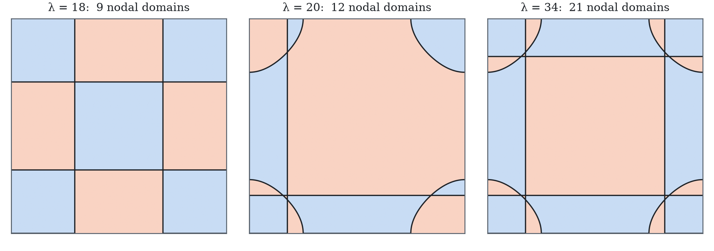
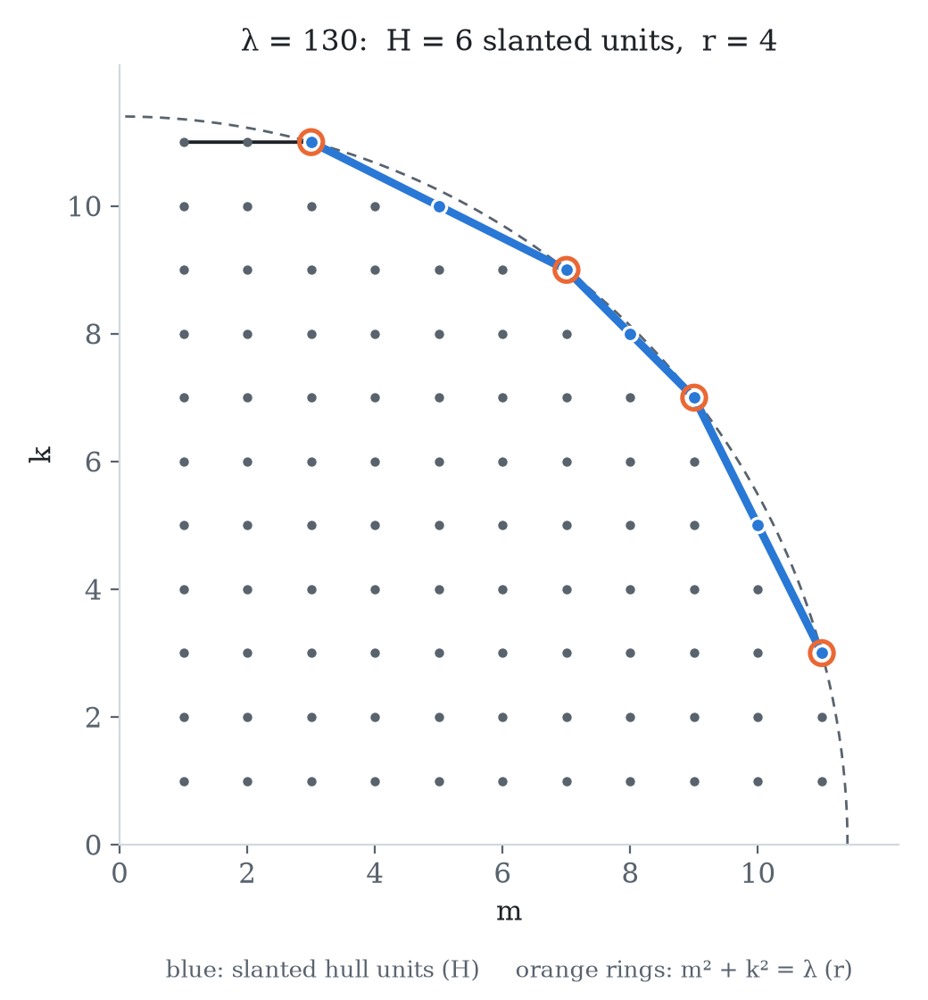
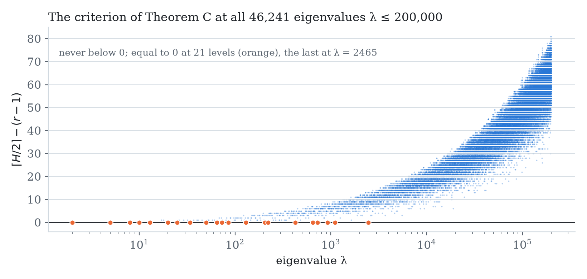

# The extended Courant property, Part I: the square

[](https://github.com/asanayei/extended-courant-square/actions/workflows/tests.yml)
[](paper/main.pdf)
[](#)
[](lean/SquareECP/RootSigns.lean)
[](LICENSE)

This repository has the source, code, data and Lean proof for the paper

> A. Sanayei, *The extended Courant property, Part I: nodal domains of linear combinations of
> eigenfunctions on the square* (2026). arXiv: to appear.

**[Read the paper (PDF)](paper/main.pdf)**

<p align="center">
  <picture>
    <source media="(prefers-color-scheme: dark)" srcset="docs/figures/nodal-dark.png">
    
  </picture>
</p>
<p align="center"><sub>Combinations of eigenfunctions of the square with the largest possible number of
nodal domains at λ = 18, 20 and 34. At 20 and 34 the count equals κ(λ), the bound in the
extended Courant property.</sub></p>

## The problem

Courant's theorem says that the n-th Dirichlet eigenfunction of a domain has at most n nodal
domains. A footnote in Courant–Hilbert claims more: any linear combination of the first n
eigenfunctions also has at most n nodal domains. This is the extended Courant property (ECP).
It is false in general, and on the square it had only been checked for the first thirteen
eigenvalues. This paper proves it on the square at every eigenvalue up to 10⁹ and at every
sufficiently large eigenvalue.

## Results

Every linear combination of the eigenfunctions `sin(mx) sin(ky)` of `(0, π)²` with
`m² + k² ≤ λ` can be written as `sin x sin y · P(cos x, cos y)`, where the exponents of `P`
lie in `S(λ) = {(a, b) : (a+1)² + (b+1)² ≤ λ}`. The paper proves the following.

| | statement | how it is checked |
|---|---|---|
| **Theorem A** | every such combination has at most `U(λ)` nodal domains | proof in the paper; corner lemma in Lean |
| **Theorem B** | `U(λ) ≤ dim E_λ`, so the Courant–Herrmann bound holds at every complete eigenspace | proof in the paper |
| **Theorem C** | `dim E_λ − U(λ) ≥ ⌈H(λ)/2⌉`, so ECP holds at λ whenever `H(λ) ≥ 2r(λ) − 3` | proof in the paper |
| **Theorem D** | ECP holds at every eigenvalue `λ ≤ 10⁹` and every sufficiently large λ | two separate C programs, plus Balog–Bárány |

Here `r(λ)` is the multiplicity of λ, and `H(λ)` counts the primitive lattice segments on the
slanted edges of the convex hull of the lattice points `(m, k)` with `m, k ≥ 1` in the
quarter disc `m² + k² ≤ λ`.

<p align="center">
  <picture>
    <source media="(prefers-color-scheme: dark)" srcset="docs/figures/hull-dark.png">
    
  </picture>
</p>
<p align="center"><sub>At λ = 130 the hull has H = 6 slanted units and the eigenvalue has
multiplicity r = 4. So ⌈H/2⌉ = 3 = r − 1, and the criterion of Theorem C holds with equality.</sub></p>

Below, the margin `⌈H/2⌉ − (r − 1)` is plotted at every eigenvalue up to 200,000. It is never
negative, it is zero at 21 eigenvalues (the last is `λ = 2465`), and after that it grows with λ.

<p align="center">
  <picture>
    <source media="(prefers-color-scheme: dark)" srcset="docs/figures/slack-dark.png">
    
  </picture>
</p>

## What is proved, and how

- Theorems A to C are proved by hand in the paper. The Python code computes the quantities in
  them and the tests check them against brute force; it is not part of the proofs.
- Theorem D for `λ ≤ 10⁹` is computer-assisted: an exact integer check of
  `H(λ) ≥ 2r(λ) − 3` at all 1.73 × 10⁸ eigenvalues, done by two C programs that share no code.
- The lemma on roots and corner signs used in Theorem A is formalised in Lean 4 with Mathlib:

  ```lean
  theorem card_roots_Ioo_add_le (p : ℝ[X]) (hp : p ≠ 0) :
      (p.roots.filter (fun x => -1 < x ∧ x < 1)).card
        + (if p.eval 1 * p.leadingCoeff < 0 then 1 else 0)
        + (if p.eval (-1) * ((-1) ^ p.natDegree * p.leadingCoeff) < 0 then 1 else 0)
        ≤ p.natDegree
  ```

  There is no `sorry`, and `#print axioms` lists only `propext`, `Classical.choice` and
  `Quot.sound`.
- The grid counts in `python/squareecp/nodal.py`, used for the pictures above, are numerical
  evidence only.

## Layout

```
paper/             LaTeX source (main.tex, refs.bib, table, figures fig_*.pdf)
paper/figures/     make_figures.py, which draws every figure in the paper from the code and data here
python/squareecp/  reference implementation in exact integer arithmetic
  lattice.py         S(λ), κ(λ), r(λ), Pick's formula, Minkowski sums, mixed area
  bound.py           corner-sign number cap(A), η(D), exhaustive evaluation of U(λ)
  deficiency.py      dynamic programme for LB(λ) ≤ dim E_λ − U(λ)
  hull_units.py      H(λ) and the slack ⌈H/2⌉ − (r − 1)
  nodal.py           grid counts for the extremal polynomials (evidence only)
python/tests/      pytest suite
c/                 the two C programs for the sweep in Theorem D
cpp/               a second implementation of U(λ) and LB(λ) in C++, written from the paper
lean/              Lean 4 + Mathlib proof of the lemma on roots and corner signs
scripts/           scripts that reproduce the tables and the README figures
data/              logs of the runs reported in the paper, and the window minima of H(λ)
                   up to 10⁹ used in the last figure of the paper
docs/figures/      the figures in this README
```

## Reproducing

```bash
# Python 3.10 or later
python -m venv .venv && .venv/bin/pip install -r requirements.txt
cd python && ../.venv/bin/python -m pytest -q && cd ..   # about 3 minutes

# Table of U(λ) for λ ≤ 130 (λ = 130 alone takes several minutes)
.venv/bin/python scripts/table_U.py 5 130

# The sweep in Theorem D, with both programs
make -C c
OMP_NUM_THREADS=16 c/hsweep2 1000000000
OMP_NUM_THREADS=16 c/hsweep  1000000000

# Lean (needs elan)
cd lean && lake exe cache get && lake build
```

The tests, and a sweep up to `10⁷` with both C programs, run on every push.

## The series

This paper is Part I of a series on the extended Courant property. Later parts are in
preparation and will have their own repositories.

## Citing

```bibtex
@article{Sanayei2026ECP1,
  author  = {Sanayei, Armaun},
  title   = {The extended {C}ourant property, {P}art {I}: nodal domains of linear
             combinations of eigenfunctions on the square},
  year    = {2026},
  note    = {arXiv: to appear}
}
```

## License

Code: MIT (see `LICENSE`). Paper: CC BY 4.0.

Questions and corrections are welcome as issues on this repository.
